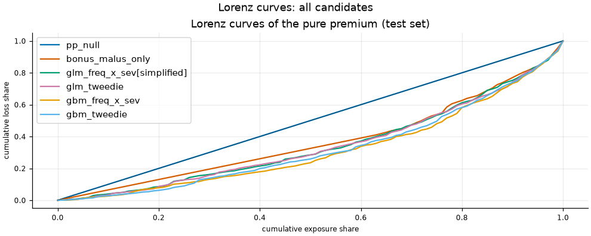
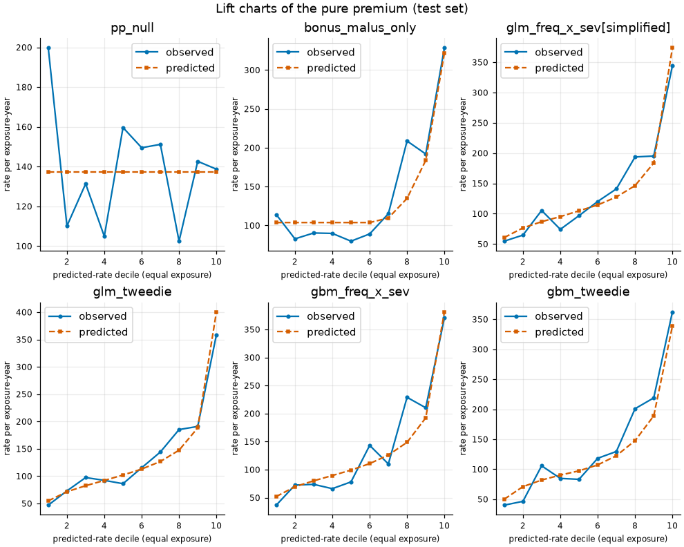

# fremtpl2-pricing

Motor third-party liability (TPL) insurers price a policy from its expected claim frequency and
claim severity; their product is the pure premium. This project asks one question on the public
freMTPL2 data: does a gradient-boosted model (LightGBM) predict the pure premium better than a
classical generalised linear model (GLM) on policies it has never seen, and how sure can we be?
The answer comes from one test evaluation, run once under a protocol written before test access, with a confidence interval.

**This is a methodology demonstration, not a production tariff.** See [`MODEL_CARD.md`](MODEL_CARD.md).

## Result

Primary contrast: the selected GBM against the selected GLM on the loss fixed in the protocol, with a paired
bootstrap over rating-profile groups. Lower loss is better; the other rows are descriptive.
All numbers below are generated from `results/metrics.json` by `make docs`.

<!-- docs:results:begin -->
Population: the primary grouped test fold, 135 602 policies, 71737.2 exposure-years, 5 321 claims on 4 978 policies, 105 759 rating-profile groups.

Primary contrast Delta = L(`gbm_freq_x_sev`) - L(`glm_freq_x_sev[simplified]`) = -1.37922 (95% group-bootstrap CI [-2.12406, -0.77571]): **improvement**.

Gini difference (normalised, secondary) = 0.05891 (95% CI [0.02616, 0.10615]).

| Candidate | Primary loss (Tweedie 1.5) | 95% CI (group bootstrap) | Normalised Gini | Gini 95% CI | Observed / predicted |
| --- | --- | --- | --- | --- | --- |
| `pp_null` | 78.197 | [74.500, 81.958] | 0.0000 | n/a | 1.0130 |
| `bonus_malus_only` | 75.510 | [71.955, 79.230] | 0.2653 | n/a | 1.0129 |
| `glm_freq_x_sev[simplified]` | 74.567 | [70.849, 78.504] | 0.3136 | [0.2577, 0.3647] | 1.0148 |
| `glm_tweedie` | 74.415 | [70.739, 78.298] | 0.3192 | n/a | 1.0081 |
| `gbm_freq_x_sev` | 73.188 | [69.631, 76.972] | 0.3725 | [0.3271, 0.4161] | 1.0303 |
| `gbm_tweedie` | 73.504 | [69.812, 77.360] | 0.3572 | n/a | 1.0731 |
<!-- docs:results:end -->





Main risk drivers of the GBM, from SHAP contributions on a fixed training sample (no test row). The
comparison with the GLM relativities is in [`reports/interpretation.md`](reports/interpretation.md).

<!-- docs:drivers:begin -->
Mean absolute TreeSHAP contribution to the raw score (log scale) on a fixed train sample of 20 000 of 542 411 train policies; no test row.

| GBM component | Top drivers (mean absolute contribution, share) |
| --- | --- |
| frequency | BonusMalus (0.3866, 39.91%), DrivAge (0.1327, 13.70%), Density (0.1035, 10.68%) |
| severity | Region (0.0456, 29.02%), DrivAge (0.0379, 24.11%), BonusMalus (0.0184, 11.70%) |
| tweedie | BonusMalus (0.3984, 41.42%), DrivAge (0.1311, 13.63%), VehAge (0.0988, 10.27%) |
<!-- docs:drivers:end -->

## Data

freMTPL2 (French motor policies, frequency and severity tables) from OpenML. Provenance and
checksums are in [`data/README.md`](data/README.md). The raw files are downloaded, never committed.

## Method

- Cleaning and targets: documented rules, with a per-claim cap on claim amounts and a flat loading
  for the excess above the cap ([`reports/data_audit.md`](reports/data_audit.md)).
- Split: grouped by rating profile (all rating factors together), so identical profiles never sit on
  both sides. The grouped split was registered as primary in
  [`reports/data_audit.md`](reports/data_audit.md) (section 8, decision of 2026-11-07) before any model was fitted.
  The selection rules, the primary contrast and the test decision rule were written in
  [`reports/evaluation_protocol.md`](reports/evaluation_protocol.md) after the GLM cross-validation and before any test access.
- Exposure enters as an offset (frequency) or a weight, never as a rating factor.
- GLMs: frequency, severity and Tweedie models with readable relativities.
- Gradient boosting: LightGBM frequency, severity and Tweedie models, tuned in grouped
  cross-validation on the training set only, with a monotone constraint on BonusMalus.
- Interpretation: SHAP contributions of the GBM against the GLM relativities, on training data.
- Evaluation: one frozen, one-shot test evaluation with a paired group bootstrap for the single
  primary contrast. No test outcome was used in training, tuning or selection. The full-data audit and the
  freeze's factor-level coverage check read test covariate levels only (no outcomes), as disclosed in the
  protocol amendment. The test set was evaluated once.

## Limits

The conclusion is conditional on the frozen models and on this dataset, and holds for held-out rating
profiles of freMTPL2 only. The full list with measured values is in the limits section of
[`reports/model_report.md`](reports/model_report.md).

## Out of scope

- Price elasticity and price optimisation: there is no price or conversion data.
- Large-loss modelling beyond the documented per-claim cap.
- Fairness or regulatory analysis of rating factors beyond the short discussion in the model card;
  the data has no protected attributes.

## Reproduce

```sh
make setup       # uv sync (installs the pinned Python and dependencies)
make all         # download, audit, split, train, gbm, sensitivities, interpret, then the freeze check
make reproduce   # rebuild the pre-test pipeline in a clean clone and compare it with the committed outputs
make docs        # re-render reports/model_report.md and the generated blocks of this README and the model card
make test lint   # offline unit tests and style checks
```

Individual stages (`make audit`, `make split`, `make train`, `make gbm`, `make interpret`) are listed in
the [`Makefile`](Makefile). The test set was opened once, so `make all` no longer runs `freeze` or
`evaluate`. After test access it rebuilds the pre-test artifacts, verifies them against the published
freeze, then validates and re-renders the published evaluation outputs. It never recomputes held-out
metrics. Settings live in `configs/`.

### Reproduction status

This section does not claim that the reproduction passed. The records below are the history of
`make reproduce`: each run rebuilds the pre-test pipeline from a fresh clone. The first run stopped
at the strict check, so its reports and figures were not compared. The second run compared all tracked
outputs: figures and CSV tables are byte-identical, every numeric value in the JSON results is
identical, and the markdown reports differ only in timing values and the GLM config-hash line, both
covered by the declared, post-hoc deviations. Three run-state fields remain uncovered (the split status text, the input hashes recorded in the interpretation results, and the rendered test report; see the records), so both the strict and
the amended verdict are FAIL. Held-out metrics were not recomputed. The records are in [`results/reproduction/`](results/reproduction/).

<!-- docs:reproduction:begin -->
Latest reproduction (fresh clone of the tested commit): commit `f9fedf11`, 2026-11-08, verdict **FAIL** (with declared deviations: **FAIL**), 23.3 minutes in total; machine Linux-6.18.33.2-microsoft-standard-WSL2-x86_64-with-glibc2.35 (x86_64, 8 CPUs), Python 3.12.15.

| Step | Minutes |
| --- | --- |
| setup | 0.0 |
| download | 0.3 |
| audit | 0.2 |
| split | 1.6 |
| train | 7.2 |
| gbm | 9.2 |
| sensitivities | 3.4 |
| interpret | 1.2 |
| freeze_check | 0.1 |
| report | 0.1 |

Declared deviations of the verification policy (`configs/reproduce.yaml`):

- The download date recorded in the raw-data metadata (data/raw/manifest.json) may differ; the raw data files must be byte-identical.
- The echo of the GLM training config and its hash (cv_glm.json, glm_cv.md) may differ in the pinned config keys that the GLM training modules do not read.
- The timing values rendered in the markdown reports (glm_cv.md, glm_sensitivities.md, gbm_cv.md) may differ; every other byte must be identical.
<!-- docs:reproduction:end -->

## Repository map

- [`reports/data_audit.md`](reports/data_audit.md): data audit and cleaning rules
- [`reports/evaluation_protocol.md`](reports/evaluation_protocol.md): protocol written before test access
- [`reports/glm_cv.md`](reports/glm_cv.md): GLM cross-validation
- [`reports/gbm_cv.md`](reports/gbm_cv.md): GBM tuning
- [`reports/glm_sensitivities.md`](reports/glm_sensitivities.md): cleaning sensitivities
- [`reports/interpretation.md`](reports/interpretation.md): SHAP against GLM relativities
- [`reports/test_evaluation.md`](reports/test_evaluation.md): the single test evaluation
- [`reports/model_report.md`](reports/model_report.md): full comparison, decisions and limits
- [`MODEL_CARD.md`](MODEL_CARD.md): intended use and caveats
- `src/fremtpl2_pricing/`: package and `fremtpl2` CLI; `configs/`: all settings; `tests/`: offline tests;
  `results/`: pipeline outputs; [`data/README.md`](data/README.md): data provenance

Not a production tariff.
