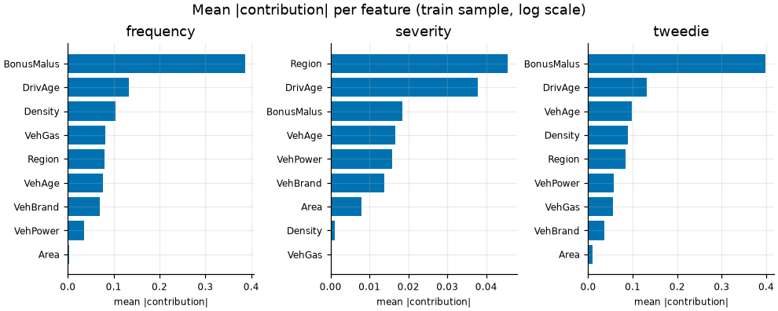
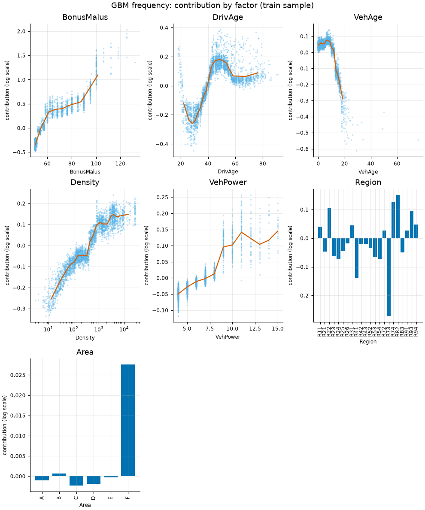
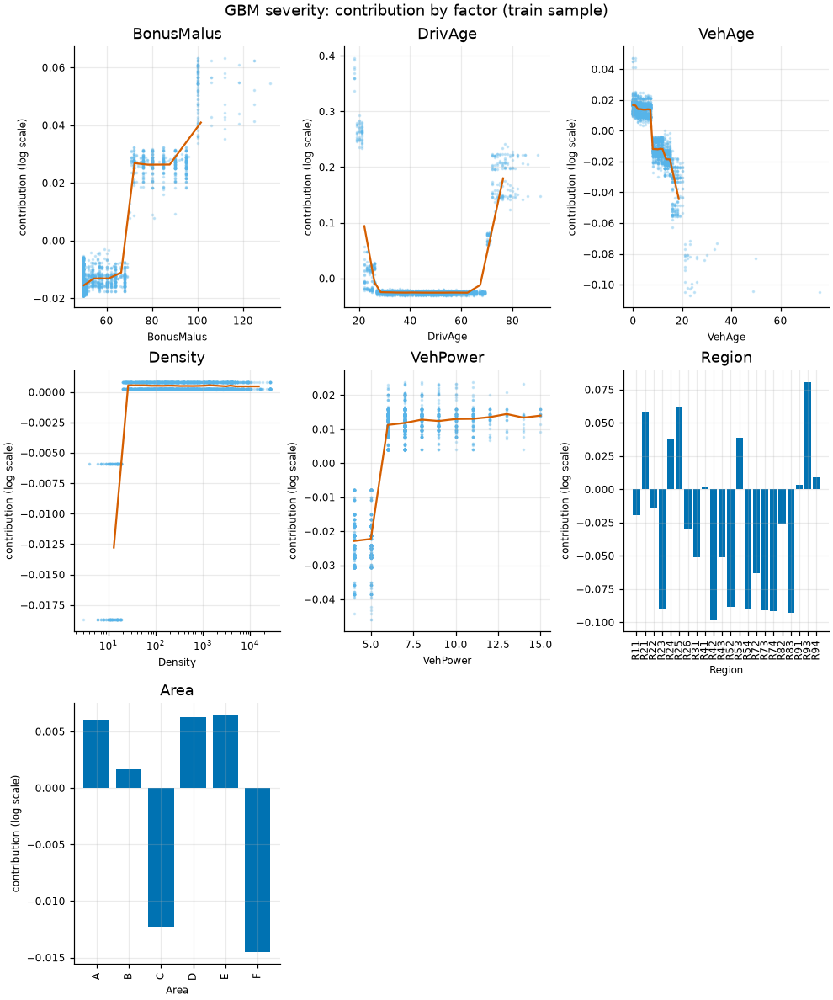
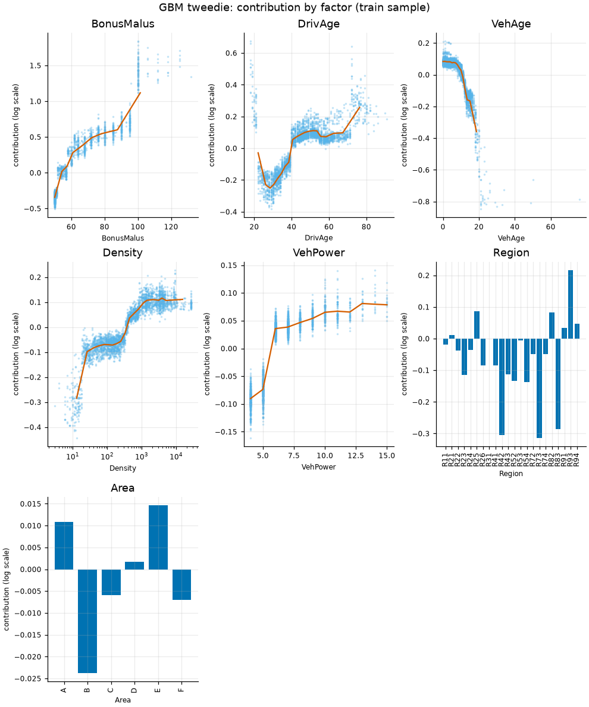
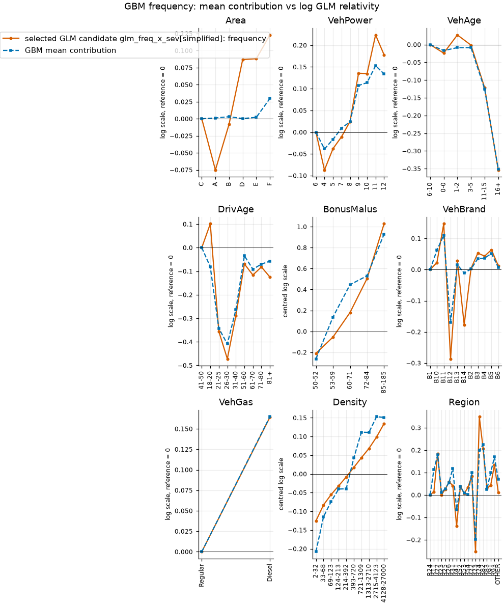
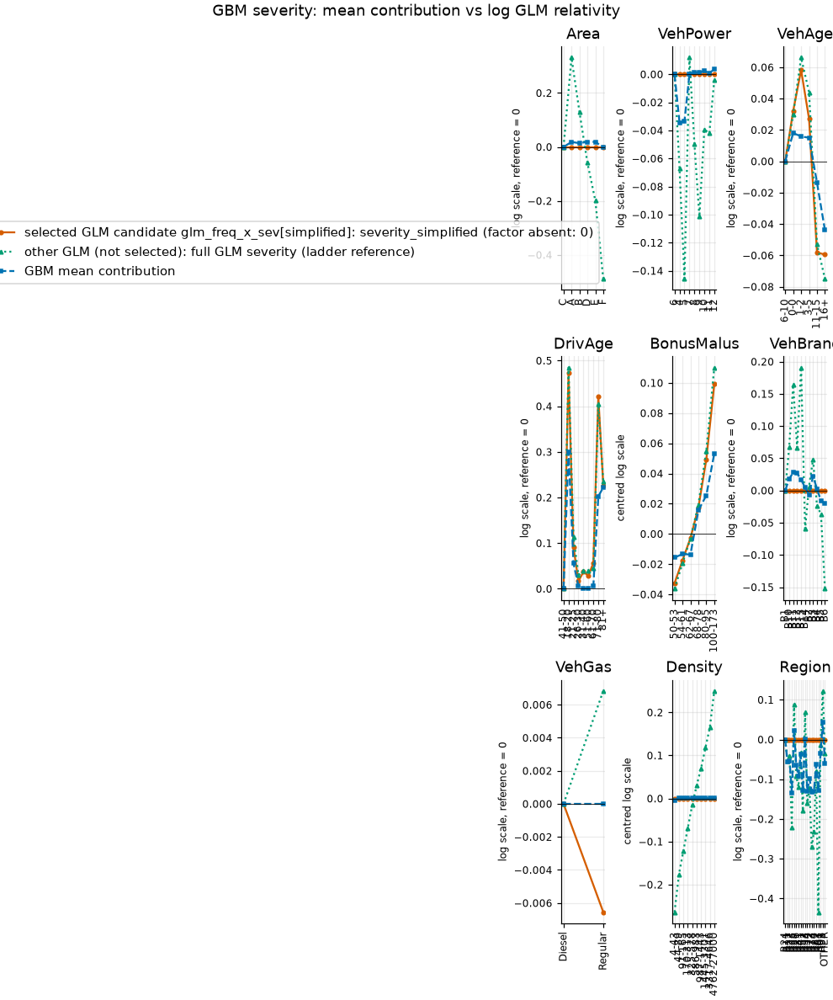
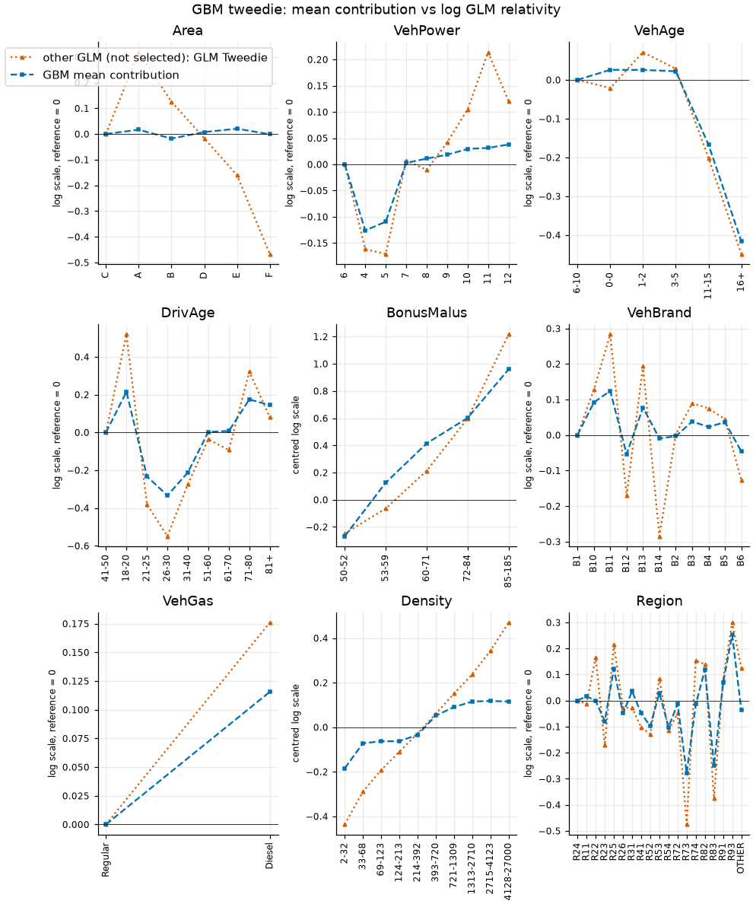
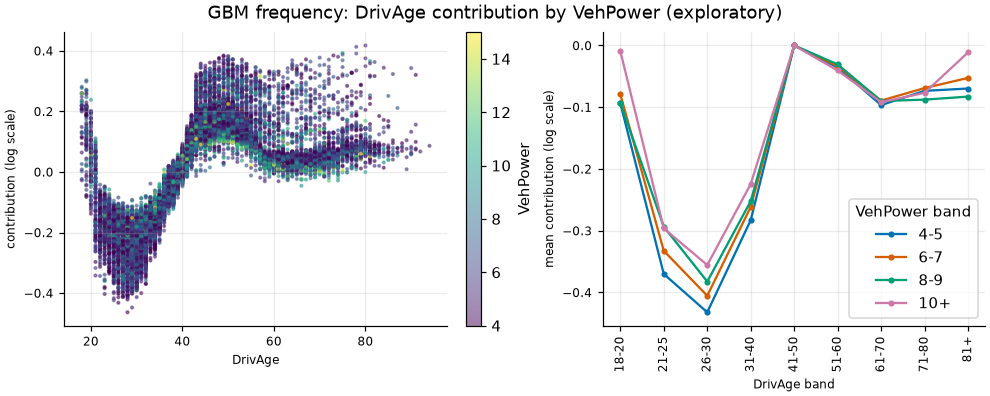

# Train-only interpretation of the frozen candidates

Generated by `fremtpl2 interpret` from `results/interpretation.json`. Descriptive, train rows only, no model is refitted, no test row is read. Nothing here feeds a selection or changes a frozen choice.

Fixed train sample: 20000 of 542411 train policies (seed 20260113, cv_fold 0..4, exposure 10567.1 years, 759 claims); the ids are recorded in the JSON (sha256 `61360dde41503e70...`). Selected candidates: GLM `glm_freq_x_sev[simplified]`, GBM `gbm_freq_x_sev`.

## 1. Contributions (TreeSHAP) of the GBM components

A contribution is the TreeSHAP attribution of one row's raw (log-scale) score to one feature, relative to the base value of the model. It describes that model on that row; it is not a coefficient and individual contributions are never equated with GLM coefficients. Group means of contributions are compared with GLM log relativities only on the aligned log scale after re-centring on the GLM reference level, and the GBM mean contribution of a level also carries the part of the effect that the model shares with correlated factors and interactions.

The frequency GBM was trained with log(Exposure) as init_score. The exposure offset is outside the contributions: the contributions (and the base value) explain the raw score, the log of the ANNUAL claim rate; the expected count is exp(raw score + log Exposure). The severity GBM has no offset; the Tweedie GBM uses Exposure only as a weight.

Per-row identity: contributions plus base value equal the raw score.

| component | base value | max abs row error | tolerance | rows | top features (mean abs) |
| --- | --- | --- | --- | --- | --- |
| frequency | -2.69580 | 1.51e-14 | 1e-09 | 20000 | BonusMalus (0.3866), DrivAge (0.1327), Density (0.1035), VehGas (0.0812) |
| severity | 7.50869 | 5.33e-15 | 1e-09 | 20000 | Region (0.0456), DrivAge (0.0379), BonusMalus (0.0184), VehAge (0.0166) |
| tweedie | 4.78313 | 1.20e-14 | 1e-09 | 20000 | BonusMalus (0.3984), DrivAge (0.1311), VehAge (0.0988), Density (0.0898) |

### Dependence: frequency

### Dependence: severity

### Dependence: tweedie

## 2. GBM contributions against GLM log relativities

mean GBM contribution per GLM level, re-centred on the GLM reference level, against the log GLM relativity exp(beta) of the stored coefficients of the GLM of the SELECTED GLM candidate for the same component (results/glm_models.json, on its own feature map and reference levels; a factor the GLM does not contain is absent, effect 0), plus any other stored GLM of the same target as a labelled extra column (aligned log scale; not coefficients).

### frequency

Population and weights: all sample rows, weighted by exposure.

GLM columns: frequency: selected GLM candidate glm_freq_x_sev[simplified]: frequency.

| factor | kind | levels / bins | frequency (selected): max abs diff / Pearson |
| --- | --- | --- | --- |
| Area | levels | 6 | 0.0932 / 0.559 |
| VehPower | levels | 9 | 0.0708 / 0.994 |
| VehAge | levels | 6 | 0.0358 / 0.995 |
| DrivAge | levels | 9 | 0.1829 / 0.917 |
| BonusMalus | continuous term | 5 | 0.2662 / 0.949 |
| VehBrand | levels | 11 | 0.1657 / 0.914 |
| VehGas | levels | 2 | 0.0006 / n/a |
| Density | continuous term | 10 | 0.0826 / 0.976 |
| Region | levels | 19 | 0.1497 / 0.910 |

Area (GBM mean contribution minus that of the GLM reference level C)

| level | n | weight | GBM mean contribution (centred) | frequency log relativity | diff frequency |
| --- | --- | --- | --- | --- | --- |
| C | 5733 | 3097.2 | 0.0000 | 0.0000 | 0.0000 |
| A | 3028 | 1807.1 | 0.0013 | -0.0752 | 0.0764 |
| B | 2183 | 1257.0 | 0.0030 | -0.0081 | 0.0111 |
| D | 4458 | 2256.8 | 0.0004 | 0.0869 | -0.0865 |
| E | 4102 | 1921.3 | 0.0021 | 0.0882 | -0.0861 |
| F | 496 | 227.8 | 0.0299 | 0.1231 | -0.0932 |

VehPower (GBM mean contribution minus that of the GLM reference level 6)

| level | n | weight | GBM mean contribution (centred) | frequency log relativity | diff frequency |
| --- | --- | --- | --- | --- | --- |
| 6 | 4429 | 2457.4 | 0.0000 | 0.0000 | 0.0000 |
| 4 | 3282 | 1737.3 | -0.0386 | -0.0871 | 0.0484 |
| 5 | 3674 | 1983.3 | -0.0168 | -0.0381 | 0.0213 |
| 7 | 4396 | 2352.9 | 0.0093 | -0.0107 | 0.0200 |
| 8 | 1399 | 671.8 | 0.0239 | 0.0245 | -0.0006 |
| 9 | 895 | 445.9 | 0.1074 | 0.1355 | -0.0282 |
| 10 | 904 | 443.9 | 0.1138 | 0.1347 | -0.0209 |
| 11 | 509 | 241.8 | 0.1529 | 0.2236 | -0.0708 |
| 12 | 512 | 232.9 | 0.1339 | 0.1778 | -0.0439 |

VehAge (GBM mean contribution minus that of the GLM reference level 6-10)

| level | n | weight | GBM mean contribution (centred) | frequency log relativity | diff frequency |
| --- | --- | --- | --- | --- | --- |
| 6-10 | 5135 | 2956.4 | 0.0000 | 0.0000 | 0.0000 |
| 0-0 | 1646 | 479.9 | -0.0170 | -0.0240 | 0.0070 |
| 1-2 | 3891 | 1879.6 | -0.0085 | 0.0273 | -0.0358 |
| 3-5 | 3909 | 2098.7 | -0.0085 | -0.0015 | -0.0070 |
| 11-15 | 3976 | 2317.8 | -0.1253 | -0.1214 | -0.0039 |
| 16+ | 1443 | 834.7 | -0.3515 | -0.3538 | 0.0022 |

DrivAge (GBM mean contribution minus that of the GLM reference level 41-50)

| level | n | weight | GBM mean contribution (centred) | frequency log relativity | diff frequency |
| --- | --- | --- | --- | --- | --- |
| 41-50 | 4929 | 2634.1 | 0.0000 | 0.0000 | 0.0000 |
| 18-20 | 214 | 79.0 | -0.0814 | 0.1015 | -0.1829 |
| 21-25 | 963 | 401.5 | -0.3425 | -0.3555 | 0.0130 |
| 26-30 | 1916 | 865.0 | -0.4091 | -0.4723 | 0.0632 |
| 31-40 | 4947 | 2436.3 | -0.2639 | -0.2898 | 0.0259 |
| 51-60 | 3993 | 2244.2 | -0.0345 | -0.0690 | 0.0346 |
| 61-70 | 1918 | 1167.0 | -0.0915 | -0.1162 | 0.0247 |
| 71-80 | 966 | 614.7 | -0.0699 | -0.0819 | 0.0120 |
| 81+ | 154 | 125.4 | -0.0572 | -0.1249 | 0.0677 |

BonusMalus (weighted mean of the bins (no reference level exists))

| bin | n | weight | GBM mean contribution (centred) | frequency effect (centred) | diff frequency |
| --- | --- | --- | --- | --- | --- |
| 50-52 | 11987 | 7001.0 | -0.2628 | -0.2102 | -0.0526 |
| 53-59 | 1633 | 833.8 | 0.1367 | -0.0547 | 0.1914 |
| 60-71 | 2233 | 1048.7 | 0.4463 | 0.1800 | 0.2662 |
| 72-84 | 1807 | 770.5 | 0.5305 | 0.5052 | 0.0253 |
| 85-185 | 2340 | 913.2 | 0.9300 | 1.0283 | -0.0983 |

VehBrand (GBM mean contribution minus that of the GLM reference level B1)

| level | n | weight | GBM mean contribution (centred) | frequency log relativity | diff frequency |
| --- | --- | --- | --- | --- | --- |
| B1 | 4709 | 2748.3 | 0.0000 | 0.0000 | 0.0000 |
| B10 | 516 | 274.7 | 0.0623 | 0.0224 | 0.0399 |
| B11 | 384 | 204.6 | 0.1108 | 0.1473 | -0.0364 |
| B12 | 4921 | 1937.5 | -0.1698 | -0.2866 | 0.1168 |
| B13 | 356 | 198.2 | 0.0159 | 0.0281 | -0.0121 |
| B14 | 118 | 66.2 | -0.0113 | -0.1770 | 0.1657 |
| B2 | 4704 | 2788.5 | 0.0020 | 0.0034 | -0.0014 |
| B3 | 1564 | 827.4 | 0.0349 | 0.0530 | -0.0180 |
| B4 | 753 | 405.5 | 0.0370 | 0.0435 | -0.0066 |
| B5 | 1061 | 625.4 | 0.0520 | 0.0636 | -0.0116 |
| B6 | 914 | 490.9 | 0.0071 | 0.0126 | -0.0055 |

VehGas (GBM mean contribution minus that of the GLM reference level Regular)

| level | n | weight | GBM mean contribution (centred) | frequency log relativity | diff frequency |
| --- | --- | --- | --- | --- | --- |
| Regular | 10112 | 5454.7 | 0.0000 | 0.0000 | 0.0000 |
| Diesel | 9888 | 5112.5 | 0.1648 | 0.1642 | 0.0006 |

Density (weighted mean of the bins (no reference level exists))

| bin | n | weight | GBM mean contribution (centred) | frequency effect (centred) | diff frequency |
| --- | --- | --- | --- | --- | --- |
| 2-32 | 1981 | 1207.4 | -0.2080 | -0.1254 | -0.0826 |
| 33-68 | 2014 | 1165.4 | -0.1147 | -0.0829 | -0.0317 |
| 69-123 | 1989 | 1109.7 | -0.0739 | -0.0553 | -0.0187 |
| 124-213 | 1959 | 1056.5 | -0.0404 | -0.0317 | -0.0087 |
| 214-392 | 2039 | 1088.9 | -0.0396 | -0.0080 | -0.0315 |
| 393-720 | 2016 | 1062.9 | 0.0424 | 0.0173 | 0.0251 |
| 721-1309 | 1806 | 911.7 | 0.1117 | 0.0433 | 0.0684 |
| 1313-2710 | 2172 | 1102.6 | 0.1109 | 0.0681 | 0.0428 |
| 2715-4123 | 1906 | 895.1 | 0.1531 | 0.0985 | 0.0546 |
| 4128-27000 | 2118 | 967.0 | 0.1513 | 0.1348 | 0.0165 |

Region (GBM mean contribution minus that of the GLM reference level R24)

| level | n | weight | GBM mean contribution (centred) | frequency log relativity | diff frequency |
| --- | --- | --- | --- | --- | --- |
| R24 | 4694 | 2978.6 | 0.0000 | 0.0000 | 0.0000 |
| R11 | 2045 | 881.1 | 0.1133 | 0.0144 | 0.0989 |
| R22 | 256 | 112.6 | 0.1786 | 0.1848 | -0.0061 |
| R23 | 250 | 97.3 | 0.0108 | 0.0008 | 0.0100 |
| R25 | 332 | 203.5 | 0.0282 | 0.0256 | 0.0026 |
| R26 | 306 | 150.1 | 0.0552 | 0.0593 | -0.0041 |
| R31 | 786 | 342.3 | 0.1190 | 0.0415 | 0.0774 |
| R41 | 397 | 248.6 | -0.0651 | -0.1384 | 0.0733 |
| R52 | 1129 | 635.9 | 0.0383 | 0.0396 | -0.0013 |
| R53 | 1271 | 831.9 | 0.0086 | 0.0056 | 0.0030 |
| R54 | 536 | 303.5 | 0.0019 | 0.0343 | -0.0325 |
| R72 | 931 | 436.6 | 0.0996 | 0.0832 | 0.0164 |
| R73 | 496 | 202.8 | -0.1977 | -0.2534 | 0.0557 |
| R74 | 123 | 67.8 | 0.1996 | 0.3493 | -0.1497 |
| R82 | 2497 | 1334.6 | 0.2248 | 0.2067 | 0.0180 |
| R83 | 145 | 59.0 | 0.0240 | 0.0290 | -0.0050 |
| R91 | 1130 | 471.1 | 0.1006 | 0.0435 | 0.0571 |
| R93 | 2340 | 1062.7 | 0.1694 | 0.1340 | 0.0354 |
| OTHER | 336 | 147.2 | 0.0696 | 0.0121 | 0.0575 |

### severity

Population and weights: claim rows of the sample only (N > 0), weighted by claim count N: the severity GBM and GLM are fitted on claims only, so rows without a claim are outside their training population and are not used.

GLM columns: severity_simplified: selected GLM candidate glm_freq_x_sev[simplified]: severity_simplified; severity: other GLM (not selected): full GLM severity (ladder reference).

Limitation: the severity GBM is compared on claim rows only and the GLM column is the severity GLM of the selected candidate; factors it does not contain show an effect of 0 (absent), whatever the GBM contribution is.

| factor | kind | levels / bins | severity_simplified (selected): max abs diff / Pearson | severity (other): max abs diff / Pearson |
| --- | --- | --- | --- | --- |
| Area | levels | 6 | absent: 0.0188 / n/a | 0.4874 / 0.524 |
| VehPower | levels | 9 | absent: 0.0345 / n/a | 0.1125 / 0.629 |
| VehAge | levels | 6 | 0.0445 / 0.897 | 0.0503 / 0.933 |
| DrivAge | levels | 9 | 0.2191 / 0.947 | 0.2024 / 0.956 |
| BonusMalus | continuous term | 6 | 0.0460 / 0.976 | 0.0570 / 0.976 |
| VehBrand | levels | 11 | absent: 0.0279 / n/a | 0.1740 / 0.806 |
| VehGas | levels | 2 | 0.0066 / n/a | 0.0068 / n/a |
| Density | continuous term | 10 | absent: 0.0041 / n/a | 0.2597 / 0.566 |
| Region | levels | 19 | absent: 0.1338 / n/a | 0.3063 / 0.903 |

Area (GBM mean contribution minus that of the GLM reference level C)

Absent from: severity_simplified (effect 0 on the log scale).

| level | n | weight | GBM mean contribution (centred) | severity_simplified log relativity | diff severity_simplified | severity log relativity | diff severity |
| --- | --- | --- | --- | --- | --- | --- | --- |
| C | 188 | 199.0 | 0.0000 | 0.0000 | 0.0000 | 0.0000 | 0.0000 |
| A | 88 | 91.0 | 0.0184 | 0.0000 | 0.0184 | 0.3309 | -0.3125 |
| B | 69 | 71.0 | 0.0139 | 0.0000 | 0.0139 | 0.1299 | -0.1160 |
| D | 188 | 198.0 | 0.0188 | 0.0000 | 0.0188 | -0.0583 | 0.0772 |
| E | 160 | 170.0 | 0.0188 | 0.0000 | 0.0188 | -0.1991 | 0.2178 |
| F | 29 | 30.0 | -0.0016 | 0.0000 | -0.0016 | -0.4890 | 0.4874 |

VehPower (GBM mean contribution minus that of the GLM reference level 6)

Absent from: severity_simplified (effect 0 on the log scale).

| level | n | weight | GBM mean contribution (centred) | severity_simplified log relativity | diff severity_simplified | severity log relativity | diff severity |
| --- | --- | --- | --- | --- | --- | --- | --- |
| 6 | 174 | 183.0 | 0.0000 | 0.0000 | 0.0000 | 0.0000 | 0.0000 |
| 4 | 106 | 115.0 | -0.0345 | 0.0000 | -0.0345 | -0.0670 | 0.0325 |
| 5 | 141 | 146.0 | -0.0333 | 0.0000 | -0.0333 | -0.1458 | 0.1125 |
| 7 | 171 | 178.0 | 0.0001 | 0.0000 | 0.0001 | 0.0119 | -0.0118 |
| 8 | 39 | 42.0 | 0.0015 | 0.0000 | 0.0015 | -0.0496 | 0.0510 |
| 9 | 36 | 36.0 | 0.0012 | 0.0000 | 0.0012 | -0.1015 | 0.1027 |
| 10 | 28 | 31.0 | 0.0024 | 0.0000 | 0.0024 | -0.0392 | 0.0416 |
| 11 | 14 | 15.0 | 0.0009 | 0.0000 | 0.0009 | -0.0421 | 0.0430 |
| 12 | 13 | 13.0 | 0.0036 | 0.0000 | 0.0036 | -0.0043 | 0.0079 |

VehAge (GBM mean contribution minus that of the GLM reference level 6-10)

| level | n | weight | GBM mean contribution (centred) | severity_simplified log relativity | diff severity_simplified | severity log relativity | diff severity |
| --- | --- | --- | --- | --- | --- | --- | --- |
| 6-10 | 215 | 225.0 | 0.0000 | 0.0000 | 0.0000 | 0.0000 | 0.0000 |
| 0-0 | 22 | 23.0 | 0.0180 | 0.0321 | -0.0141 | 0.0301 | -0.0120 |
| 1-2 | 117 | 126.0 | 0.0159 | 0.0583 | -0.0424 | 0.0662 | -0.0503 |
| 3-5 | 157 | 165.0 | 0.0150 | 0.0271 | -0.0121 | 0.0441 | -0.0290 |
| 11-15 | 160 | 165.0 | -0.0136 | -0.0581 | 0.0445 | -0.0530 | 0.0394 |
| 16+ | 51 | 55.0 | -0.0439 | -0.0595 | 0.0156 | -0.0750 | 0.0311 |

DrivAge (GBM mean contribution minus that of the GLM reference level 41-50)

| level | n | weight | GBM mean contribution (centred) | severity_simplified log relativity | diff severity_simplified | severity log relativity | diff severity |
| --- | --- | --- | --- | --- | --- | --- | --- |
| 41-50 | 212 | 218.0 | 0.0000 | 0.0000 | 0.0000 | 0.0000 | 0.0000 |
| 18-20 | 10 | 10.0 | 0.3000 | 0.4732 | -0.1733 | 0.4848 | -0.1848 |
| 21-25 | 46 | 49.0 | 0.0559 | 0.0912 | -0.0353 | 0.1131 | -0.0572 |
| 26-30 | 61 | 65.0 | 0.0066 | 0.0167 | -0.0101 | 0.0300 | -0.0234 |
| 31-40 | 139 | 147.0 | 0.0010 | 0.0369 | -0.0359 | 0.0391 | -0.0381 |
| 51-60 | 139 | 145.0 | 0.0002 | 0.0287 | -0.0285 | 0.0396 | -0.0394 |
| 61-70 | 67 | 70.0 | 0.0057 | 0.0564 | -0.0507 | 0.0446 | -0.0389 |
| 71-80 | 41 | 47.0 | 0.2025 | 0.4216 | -0.2191 | 0.4049 | -0.2024 |
| 81+ | 7 | 8.0 | 0.2221 | 0.2262 | -0.0042 | 0.2342 | -0.0121 |

BonusMalus (weighted mean of the bins (no reference level exists))

| bin | n | weight | GBM mean contribution (centred) | severity_simplified effect (centred) | diff severity_simplified | severity effect (centred) | diff severity |
| --- | --- | --- | --- | --- | --- | --- | --- |
| 50-53 | 356 | 372.0 | -0.0157 | -0.0327 | 0.0169 | -0.0363 | 0.0206 |
| 54-61 | 70 | 70.0 | -0.0133 | -0.0175 | 0.0042 | -0.0194 | 0.0061 |
| 62-67 | 64 | 67.0 | -0.0137 | -0.0028 | -0.0109 | -0.0031 | -0.0106 |
| 68-78 | 74 | 82.0 | 0.0156 | 0.0174 | -0.0018 | 0.0194 | -0.0038 |
| 80-95 | 85 | 91.0 | 0.0255 | 0.0494 | -0.0239 | 0.0549 | -0.0294 |
| 100-173 | 73 | 77.0 | 0.0531 | 0.0991 | -0.0460 | 0.1102 | -0.0570 |

VehBrand (GBM mean contribution minus that of the GLM reference level B1)

Absent from: severity_simplified (effect 0 on the log scale).

| level | n | weight | GBM mean contribution (centred) | severity_simplified log relativity | diff severity_simplified | severity log relativity | diff severity |
| --- | --- | --- | --- | --- | --- | --- | --- |
| B1 | 180 | 189.0 | 0.0000 | 0.0000 | 0.0000 | 0.0000 | 0.0000 |
| B10 | 19 | 20.0 | 0.0180 | 0.0000 | 0.0180 | 0.0679 | -0.0499 |
| B11 | 16 | 16.0 | 0.0279 | 0.0000 | 0.0279 | 0.1640 | -0.1361 |
| B12 | 97 | 108.0 | 0.0266 | 0.0000 | 0.0266 | 0.0665 | -0.0399 |
| B13 | 14 | 14.0 | 0.0169 | 0.0000 | 0.0169 | 0.1909 | -0.1740 |
| B14 | 3 | 3.0 | 0.0047 | 0.0000 | 0.0047 | -0.0596 | 0.0642 |
| B2 | 211 | 219.0 | -0.0065 | 0.0000 | -0.0065 | 0.0067 | -0.0132 |
| B3 | 65 | 65.0 | 0.0221 | 0.0000 | 0.0221 | 0.0480 | -0.0259 |
| B4 | 34 | 38.0 | 0.0027 | 0.0000 | 0.0027 | -0.0237 | 0.0264 |
| B5 | 47 | 49.0 | -0.0161 | 0.0000 | -0.0161 | -0.0368 | 0.0207 |
| B6 | 36 | 38.0 | -0.0199 | 0.0000 | -0.0199 | -0.1525 | 0.1326 |

VehGas (GBM mean contribution minus that of the GLM reference level Diesel)

| level | n | weight | GBM mean contribution (centred) | severity_simplified log relativity | diff severity_simplified | severity log relativity | diff severity |
| --- | --- | --- | --- | --- | --- | --- | --- |
| Diesel | 372 | 387.0 | 0.0000 | 0.0000 | 0.0000 | 0.0000 | 0.0000 |
| Regular | 350 | 372.0 | 0.0000 | -0.0066 | 0.0066 | 0.0068 | -0.0068 |

Density (weighted mean of the bins (no reference level exists))

Absent from: severity_simplified (effect 0 on the log scale).

| bin | n | weight | GBM mean contribution (centred) | severity_simplified effect (centred) | diff severity_simplified | severity effect (centred) | diff severity |
| --- | --- | --- | --- | --- | --- | --- | --- |
| 4-43 | 73 | 76.0 | -0.0041 | 0.0000 | -0.0041 | -0.2638 | 0.2597 |
| 44-89 | 70 | 71.0 | 0.0005 | 0.0000 | 0.0005 | -0.1758 | 0.1763 |
| 91-165 | 73 | 79.0 | 0.0005 | 0.0000 | 0.0005 | -0.1213 | 0.1218 |
| 170-313 | 73 | 77.0 | 0.0004 | 0.0000 | 0.0004 | -0.0687 | 0.0691 |
| 325-578 | 72 | 75.0 | 0.0004 | 0.0000 | 0.0004 | -0.0149 | 0.0153 |
| 586-983 | 72 | 76.0 | 0.0004 | 0.0000 | 0.0004 | 0.0299 | -0.0295 |
| 987-1443 | 71 | 76.0 | 0.0005 | 0.0000 | 0.0005 | 0.0699 | -0.0694 |
| 1445-3301 | 70 | 74.0 | 0.0004 | 0.0000 | 0.0004 | 0.1176 | -0.1172 |
| 3317-4646 | 74 | 77.0 | 0.0005 | 0.0000 | 0.0005 | 0.1654 | -0.1649 |
| 4762-27000 | 74 | 78.0 | 0.0004 | 0.0000 | 0.0004 | 0.2500 | -0.2495 |

Region (GBM mean contribution minus that of the GLM reference level R24)

Absent from: severity_simplified (effect 0 on the log scale).

| level | n | weight | GBM mean contribution (centred) | severity_simplified log relativity | diff severity_simplified | severity log relativity | diff severity |
| --- | --- | --- | --- | --- | --- | --- | --- |
| R24 | 181 | 187.0 | 0.0000 | 0.0000 | 0.0000 | 0.0000 | 0.0000 |
| R11 | 83 | 88.0 | -0.0565 | 0.0000 | -0.0565 | -0.0532 | -0.0033 |
| R22 | 5 | 5.0 | -0.0540 | 0.0000 | -0.0540 | -0.0416 | -0.0123 |
| R23 | 5 | 5.0 | -0.1338 | 0.0000 | -0.1338 | -0.2221 | 0.0883 |
| R25 | 17 | 17.0 | 0.0218 | 0.0000 | 0.0218 | 0.0885 | -0.0667 |
| R26 | 5 | 6.0 | -0.0642 | 0.0000 | -0.0642 | -0.0920 | 0.0278 |
| R31 | 28 | 30.0 | -0.0922 | 0.0000 | -0.0922 | -0.1187 | 0.0265 |
| R41 | 14 | 14.0 | -0.0370 | 0.0000 | -0.0370 | -0.0329 | -0.0041 |
| R52 | 44 | 44.0 | -0.1279 | 0.0000 | -0.1279 | -0.1797 | 0.0517 |
| R53 | 52 | 54.0 | 0.0022 | 0.0000 | 0.0022 | 0.0684 | -0.0662 |
| R54 | 17 | 21.0 | -0.1298 | 0.0000 | -0.1298 | -0.1590 | 0.0292 |
| R72 | 28 | 28.0 | -0.0985 | 0.0000 | -0.0985 | -0.1221 | 0.0236 |
| R73 | 10 | 10.0 | -0.1318 | 0.0000 | -0.1318 | -0.2707 | 0.1389 |
| R74 | 4 | 4.0 | -0.1311 | 0.0000 | -0.1311 | -0.2328 | 0.1017 |
| R82 | 102 | 106.0 | -0.0633 | 0.0000 | -0.0633 | -0.0792 | 0.0159 |
| R83 | 2 | 2.0 | -0.1280 | 0.0000 | -0.1280 | -0.4343 | 0.3063 |
| R91 | 26 | 29.0 | -0.0350 | 0.0000 | -0.0350 | -0.0147 | -0.0203 |
| R93 | 93 | 102.0 | 0.0431 | 0.0000 | 0.0431 | 0.1224 | -0.0793 |
| OTHER | 6 | 7.0 | -0.0602 | 0.0000 | -0.0602 | -0.0355 | -0.0247 |

### tweedie

Population and weights: all sample rows, weighted by exposure.

GLM columns: tweedie: other GLM (not selected): GLM Tweedie.

| factor | kind | levels / bins | tweedie (other): max abs diff / Pearson |
| --- | --- | --- | --- |
| Area | levels | 6 | 0.4659 / 0.055 |
| VehPower | levels | 9 | 0.1826 / 0.901 |
| VehAge | levels | 6 | 0.0472 / 0.988 |
| DrivAge | levels | 9 | 0.3044 / 0.959 |
| BonusMalus | continuous term | 5 | 0.2573 / 0.961 |
| VehBrand | levels | 11 | 0.2753 / 0.875 |
| VehGas | levels | 2 | 0.0603 / n/a |
| Density | continuous term | 10 | 0.3542 / 0.954 |
| Region | levels | 19 | 0.1972 / 0.909 |

Area (GBM mean contribution minus that of the GLM reference level C)

| level | n | weight | GBM mean contribution (centred) | tweedie log relativity | diff tweedie |
| --- | --- | --- | --- | --- | --- |
| C | 5733 | 3097.2 | 0.0000 | 0.0000 | 0.0000 |
| A | 3028 | 1807.1 | 0.0167 | 0.3182 | -0.3015 |
| B | 2183 | 1257.0 | -0.0179 | 0.1256 | -0.1435 |
| D | 4458 | 2256.8 | 0.0076 | -0.0170 | 0.0245 |
| E | 4102 | 1921.3 | 0.0205 | -0.1603 | 0.1809 |
| F | 496 | 227.8 | -0.0011 | -0.4670 | 0.4659 |

VehPower (GBM mean contribution minus that of the GLM reference level 6)

| level | n | weight | GBM mean contribution (centred) | tweedie log relativity | diff tweedie |
| --- | --- | --- | --- | --- | --- |
| 6 | 4429 | 2457.4 | 0.0000 | 0.0000 | 0.0000 |
| 4 | 3282 | 1737.3 | -0.1260 | -0.1618 | 0.0358 |
| 5 | 3674 | 1983.3 | -0.1094 | -0.1710 | 0.0616 |
| 7 | 4396 | 2352.9 | 0.0028 | 0.0072 | -0.0045 |
| 8 | 1399 | 671.8 | 0.0110 | -0.0104 | 0.0215 |
| 9 | 895 | 445.9 | 0.0184 | 0.0419 | -0.0235 |
| 10 | 904 | 443.9 | 0.0294 | 0.1048 | -0.0755 |
| 11 | 509 | 241.8 | 0.0314 | 0.2140 | -0.1826 |
| 12 | 512 | 232.9 | 0.0379 | 0.1205 | -0.0826 |

VehAge (GBM mean contribution minus that of the GLM reference level 6-10)

| level | n | weight | GBM mean contribution (centred) | tweedie log relativity | diff tweedie |
| --- | --- | --- | --- | --- | --- |
| 6-10 | 5135 | 2956.4 | 0.0000 | 0.0000 | 0.0000 |
| 0-0 | 1646 | 479.9 | 0.0260 | -0.0212 | 0.0472 |
| 1-2 | 3891 | 1879.6 | 0.0257 | 0.0714 | -0.0458 |
| 3-5 | 3909 | 2098.7 | 0.0222 | 0.0286 | -0.0064 |
| 11-15 | 3976 | 2317.8 | -0.1673 | -0.2016 | 0.0343 |
| 16+ | 1443 | 834.7 | -0.4162 | -0.4492 | 0.0330 |

DrivAge (GBM mean contribution minus that of the GLM reference level 41-50)

| level | n | weight | GBM mean contribution (centred) | tweedie log relativity | diff tweedie |
| --- | --- | --- | --- | --- | --- |
| 41-50 | 4929 | 2634.1 | 0.0000 | 0.0000 | 0.0000 |
| 18-20 | 214 | 79.0 | 0.2147 | 0.5191 | -0.3044 |
| 21-25 | 963 | 401.5 | -0.2327 | -0.3811 | 0.1484 |
| 26-30 | 1916 | 865.0 | -0.3342 | -0.5494 | 0.2152 |
| 31-40 | 4947 | 2436.3 | -0.2117 | -0.2740 | 0.0623 |
| 51-60 | 3993 | 2244.2 | 0.0029 | -0.0364 | 0.0394 |
| 61-70 | 1918 | 1167.0 | 0.0076 | -0.0935 | 0.1012 |
| 71-80 | 966 | 614.7 | 0.1747 | 0.3215 | -0.1468 |
| 81+ | 154 | 125.4 | 0.1442 | 0.0800 | 0.0641 |

BonusMalus (weighted mean of the bins (no reference level exists))

| bin | n | weight | GBM mean contribution (centred) | tweedie effect (centred) | diff tweedie |
| --- | --- | --- | --- | --- | --- |
| 50-52 | 11987 | 7001.0 | -0.2684 | -0.2487 | -0.0197 |
| 53-59 | 1633 | 833.8 | 0.1254 | -0.0647 | 0.1901 |
| 60-71 | 2233 | 1048.7 | 0.4145 | 0.2130 | 0.2014 |
| 72-84 | 1807 | 770.5 | 0.6020 | 0.5978 | 0.0042 |
| 85-185 | 2340 | 913.2 | 0.9594 | 1.2167 | -0.2573 |

VehBrand (GBM mean contribution minus that of the GLM reference level B1)

| level | n | weight | GBM mean contribution (centred) | tweedie log relativity | diff tweedie |
| --- | --- | --- | --- | --- | --- |
| B1 | 4709 | 2748.3 | 0.0000 | 0.0000 | 0.0000 |
| B10 | 516 | 274.7 | 0.0917 | 0.1271 | -0.0354 |
| B11 | 384 | 204.6 | 0.1243 | 0.2835 | -0.1592 |
| B12 | 4921 | 1937.5 | -0.0537 | -0.1702 | 0.1166 |
| B13 | 356 | 198.2 | 0.0773 | 0.1935 | -0.1162 |
| B14 | 118 | 66.2 | -0.0096 | -0.2848 | 0.2753 |
| B2 | 4704 | 2788.5 | -0.0036 | 0.0019 | -0.0055 |
| B3 | 1564 | 827.4 | 0.0382 | 0.0895 | -0.0514 |
| B4 | 753 | 405.5 | 0.0228 | 0.0753 | -0.0524 |
| B5 | 1061 | 625.4 | 0.0361 | 0.0445 | -0.0083 |
| B6 | 914 | 490.9 | -0.0459 | -0.1276 | 0.0817 |

VehGas (GBM mean contribution minus that of the GLM reference level Regular)

| level | n | weight | GBM mean contribution (centred) | tweedie log relativity | diff tweedie |
| --- | --- | --- | --- | --- | --- |
| Regular | 10112 | 5454.7 | 0.0000 | 0.0000 | 0.0000 |
| Diesel | 9888 | 5112.5 | 0.1156 | 0.1759 | -0.0603 |

Density (weighted mean of the bins (no reference level exists))

| bin | n | weight | GBM mean contribution (centred) | tweedie effect (centred) | diff tweedie |
| --- | --- | --- | --- | --- | --- |
| 2-32 | 1981 | 1207.4 | -0.1842 | -0.4366 | 0.2524 |
| 33-68 | 2014 | 1165.4 | -0.0720 | -0.2887 | 0.2167 |
| 69-123 | 1989 | 1109.7 | -0.0636 | -0.1924 | 0.1288 |
| 124-213 | 1959 | 1056.5 | -0.0627 | -0.1104 | 0.0477 |
| 214-392 | 2039 | 1088.9 | -0.0346 | -0.0280 | -0.0066 |
| 393-720 | 2016 | 1062.9 | 0.0518 | 0.0603 | -0.0086 |
| 721-1309 | 1806 | 911.7 | 0.0904 | 0.1509 | -0.0605 |
| 1313-2710 | 2172 | 1102.6 | 0.1148 | 0.2373 | -0.1224 |
| 2715-4123 | 1906 | 895.1 | 0.1178 | 0.3431 | -0.2253 |
| 4128-27000 | 2118 | 967.0 | 0.1151 | 0.4693 | -0.3542 |

Region (GBM mean contribution minus that of the GLM reference level R24)

| level | n | weight | GBM mean contribution (centred) | tweedie log relativity | diff tweedie |
| --- | --- | --- | --- | --- | --- |
| R24 | 4694 | 2978.6 | 0.0000 | 0.0000 | 0.0000 |
| R11 | 2045 | 881.1 | 0.0169 | -0.0131 | 0.0300 |
| R22 | 256 | 112.6 | -0.0014 | 0.1659 | -0.1673 |
| R23 | 250 | 97.3 | -0.0789 | -0.1712 | 0.0923 |
| R25 | 332 | 203.5 | 0.1219 | 0.2152 | -0.0933 |
| R26 | 306 | 150.1 | -0.0489 | -0.0274 | -0.0215 |
| R31 | 786 | 342.3 | 0.0358 | -0.0278 | 0.0636 |
| R41 | 397 | 248.6 | -0.0485 | -0.1032 | 0.0548 |
| R52 | 1129 | 635.9 | -0.0986 | -0.1284 | 0.0298 |
| R53 | 1271 | 831.9 | 0.0297 | 0.0835 | -0.0538 |
| R54 | 536 | 303.5 | -0.1019 | -0.1158 | 0.0139 |
| R72 | 931 | 436.6 | -0.0129 | -0.0487 | 0.0358 |
| R73 | 496 | 202.8 | -0.2782 | -0.4754 | 0.1972 |
| R74 | 123 | 67.8 | -0.0141 | 0.1528 | -0.1669 |
| R82 | 2497 | 1334.6 | 0.1192 | 0.1399 | -0.0207 |
| R83 | 145 | 59.0 | -0.2495 | -0.3754 | 0.1259 |
| R91 | 1130 | 471.1 | 0.0686 | 0.0810 | -0.0124 |
| R93 | 2340 | 1062.7 | 0.2521 | 0.2992 | -0.0472 |
| OTHER | 336 | 147.2 | -0.0372 | 0.1252 | -0.1625 |

## 3. Interaction note: young drivers x vehicle power (exploratory)

Component: GBM frequency. exploratory and descriptive, train sample only; no GLM interaction is refitted (deferred by the 2026-11-08 amendment); the DrivAge contribution varies with VehPower only through the interactions the trees learned, shared with the VehPower contribution.

Mean DrivAge contribution per DrivAge band within each VehPower band, centred on the reference band 41-50 of the same VehPower band (exposure-weighted over the sample; cells below 50 exposure-years are marked thin and not to be read).

| DrivAge band \ VehPower band | 4-5 | 6-7 | 8-9 | 10+ |
| --- | --- | --- | --- | --- |
| 18-20 | -0.094 (thin) | -0.079 (thin) | -0.093 (thin) | -0.009 (thin) |
| 21-25 | -0.370 | -0.333 | -0.293 (thin) | -0.296 (thin) |
| 26-30 | -0.432 | -0.405 | -0.382 | -0.356 (thin) |
| 31-40 | -0.283 | -0.261 | -0.252 | -0.224 |
| 41-50 | 0.000 | 0.000 | 0.000 | 0.000 |
| 51-60 | -0.036 | -0.033 | -0.031 | -0.040 |
| 61-70 | -0.097 | -0.089 | -0.090 | -0.092 |
| 71-80 | -0.073 | -0.069 | -0.088 (thin) | -0.077 (thin) |
| 81+ | -0.070 | -0.053 | -0.083 (thin) | -0.011 (thin) |

| VehPower band | n | exposure | young bands (18-20, 21-25) minus reference band |
| --- | --- | --- | --- |
| 4-5 | 6956 | 3720.6 | -0.328 |
| 6-7 | 8825 | 4810.3 | -0.291 |
| 8-9 | 2294 | 1117.6 | -0.246 |
| 10+ | 1925 | 918.6 | -0.244 |

Range of that young-driver effect across VehPower bands: 0.085 (log scale). The pattern is a description of what the trees learned on the train sample, not a tested interaction; no GLM interaction was refitted.

## 4. BonusMalus monotonicity of the pure premium (PM-M3-1)

pure premium of each candidate along a BonusMalus sweep, all other features fixed at the row's own values; a decrease is a relative step below -tolerance between consecutive points; the sweep points are the distinct train BonusMalus values or, if there are more than max_points, an equally spaced grid from the train minimum to the train maximum (so a decrease between two consecutive points of the grid is not seen); the rows swept are a fixed train sub-sample; a diagnostic on train rows that feeds no selection (2000 rows, 112 BonusMalus points 50..230, distinct train values; tolerance 1e-12).

Only the frequency and the Tweedie GBM are constrained to be non-decreasing in BonusMalus. The GBM frequency x severity pure premium is a product with the unconstrained severity GBM and is not guaranteed to be monotone; a decrease is reported as a limit, never retuned.

| candidate | constraint | rows with a decrease | share of rows with any decrease | largest relative decrease | components (share / largest) |
| --- | --- | --- | --- | --- | --- |
| pp_null | frequency: constant; severity: constant | 0 | 0.00% | 0.00% | frequency: 0.00% / 0.00%, severity: 0.00% / 0.00% |
| bonus_malus_only | frequency: GLM (log-linear in BonusMalus); severity: constant | 0 | 0.00% | 0.00% | frequency: 0.00% / 0.00%, severity: 0.00% / 0.00% |
| glm_freq_x_sev[simplified] | frequency: GLM (log-linear in BonusMalus); severity: GLM (log-linear in BonusMalus) | 0 | 0.00% | 0.00% | frequency: 0.00% / 0.00%, severity: 0.00% / 0.00% |
| glm_tweedie | pure_premium: GLM (log-linear in BonusMalus) | 0 | 0.00% | 0.00% | - |
| gbm_freq_x_sev | frequency: GBM constrained; severity: GBM unconstrained | 327 | 16.35% | 1.55% | frequency: 0.00% / 0.00%, severity: 16.35% / 1.55% |
| gbm_tweedie | pure_premium: GBM constrained | 0 | 0.00% | 0.00% | - |

## 5. Constraint register

**Rationale.** A worse claims record (higher BonusMalus) should not lower the expected claim frequency or pure premium: the constraint removes non-monotone artefacts of a tree ensemble on this factor. It is frozen in protocol section 5 (frequency Poisson and Tweedie GBMs non-decreasing in BonusMalus; severity Gamma GBM and all other factors unconstrained).

**Implementation.** LightGBM monotone_constraints on the BonusMalus column (1 = non-decreasing), fixed in config models.gbm.components.*.monotone.

| component | constraint vector | feature order | method | rounds |
| --- | --- | --- | --- | --- |
| frequency | [0, 0, 0, 1, 0, 0, 0, 0, 0] | DrivAge, VehAge, VehPower, BonusMalus, Density, Area, VehGas, VehBrand, Region | basic | 772 |
| severity | None | DrivAge, VehAge, VehPower, BonusMalus, Density, Area, VehGas, VehBrand, Region | basic | 46 |
| tweedie | [0, 0, 0, 1, 0, 0, 0, 0, 0] | DrivAge, VehAge, VehPower, BonusMalus, Density, Area, VehGas, VehBrand, Region | basic | 224 |

**Verification.** the raw-score sweep of the constrained components must not decrease (minimum step >= -tolerance); the severity GBM is unconstrained and listed for comparison; the pure premium sweep is in the monotonicity block. Sweep of 200 train rows over 112 BonusMalus points; the training gate recorded in `results/cv_gbm.json` is {'frequency:BonusMalus': 0.0, 'tweedie:BonusMalus': 0.0}.

| component | constrained | min step of the raw score |
| --- | --- | --- |
| frequency | True | 0.000e+00 |
| severity | False | -1.565e-02 |
| tweedie | True | 0.000e+00 |

**CV effect.** CV-only diagnostic of the frozen monotone constraint; never a candidate and never an input of any selection. differences are unconstrained minus constrained: a negative value means the unconstrained variant has the lower (better) loss. optimistic tuning scores of CV folds also used for early stopping and grid scoring; not unbiased estimates and not test results.

Comparison of separately tuned procedures: comparison of two separately tuned procedures (identical grid, folds, seed and budget), so the hyperparameters and rounds differ between the variants.

| quantity (unconstrained minus constrained) | mean over folds | folds with the unconstrained variant better |
| --- | --- | --- |
| frequency component loss | -0.00279 | 5/5 |
| tweedie component loss | -0.17733 | 5/5 |
| diff_freq_x_sev_unconstrained_minus_constrained | -0.23598 | 5/5 |
| diff_tweedie_unconstrained_minus_constrained | -0.17733 | 5/5 |

Controlled ablation: same chosen hyperparameters and rounds, the constraint toggled.

| component | loss | rounds | mean over folds (unconstrained minus constrained) | folds with the unconstrained variant better |
| --- | --- | --- | --- | --- |
| frequency | component loss | 772 | -0.00245 | 5/5 |
| frequency | primary loss | 772 | -0.25051 | 5/5 |
| tweedie | component loss | 224 | -0.16096 | 5/5 |
| tweedie | primary loss | 224 | -0.16096 | 5/5 |

**Grid-edge disclosure.** The hyperparameter grid was committed before tuning and was not extended after seeing the CV results. The grid axes have 2 values; 9 of the 9 chosen values lie on the lowest or highest value of their axis, so the optimum may lie outside the grid along those axes (with two values per axis every chosen value is on the boundary); the chosen points are not claimed to be the most complex or the simplest model of the grid.

| component | hyperparameter | chosen | grid | position in the grid |
| --- | --- | --- | --- | --- |
| frequency | num_leaves | 16 | [8, 16] | highest grid value |
| frequency | min_child_samples | 2000 | [500, 2000] | highest grid value |
| frequency | learning_rate | 0.025 | [0.05, 0.025] | lowest grid value |
| severity | num_leaves | 4 | [4, 8] | lowest grid value |
| severity | min_child_samples | 100 | [100, 400] | lowest grid value |
| severity | learning_rate | 0.05 | [0.05, 0.02] | highest grid value |
| tweedie | num_leaves | 8 | [8, 16] | lowest grid value |
| tweedie | min_child_samples | 500 | [500, 2000] | lowest grid value |
| tweedie | learning_rate | 0.025 | [0.05, 0.025] | lowest grid value |
