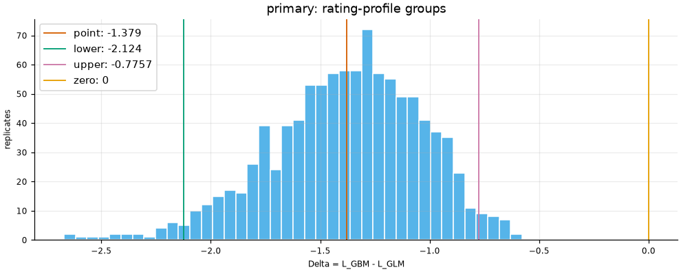
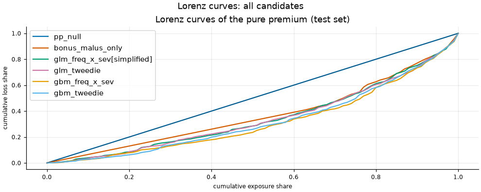
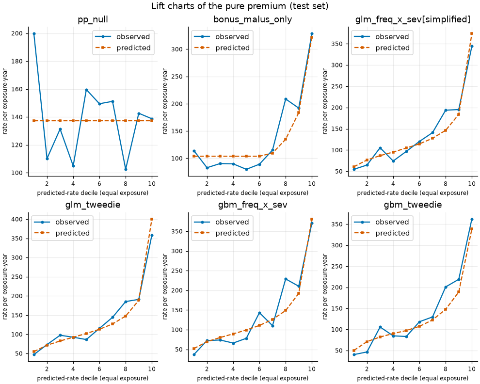
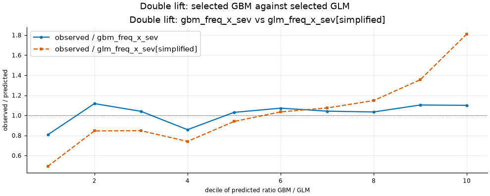
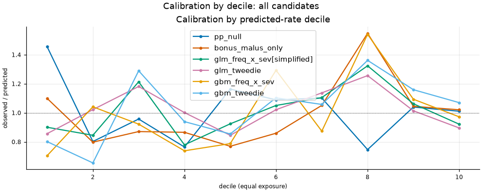
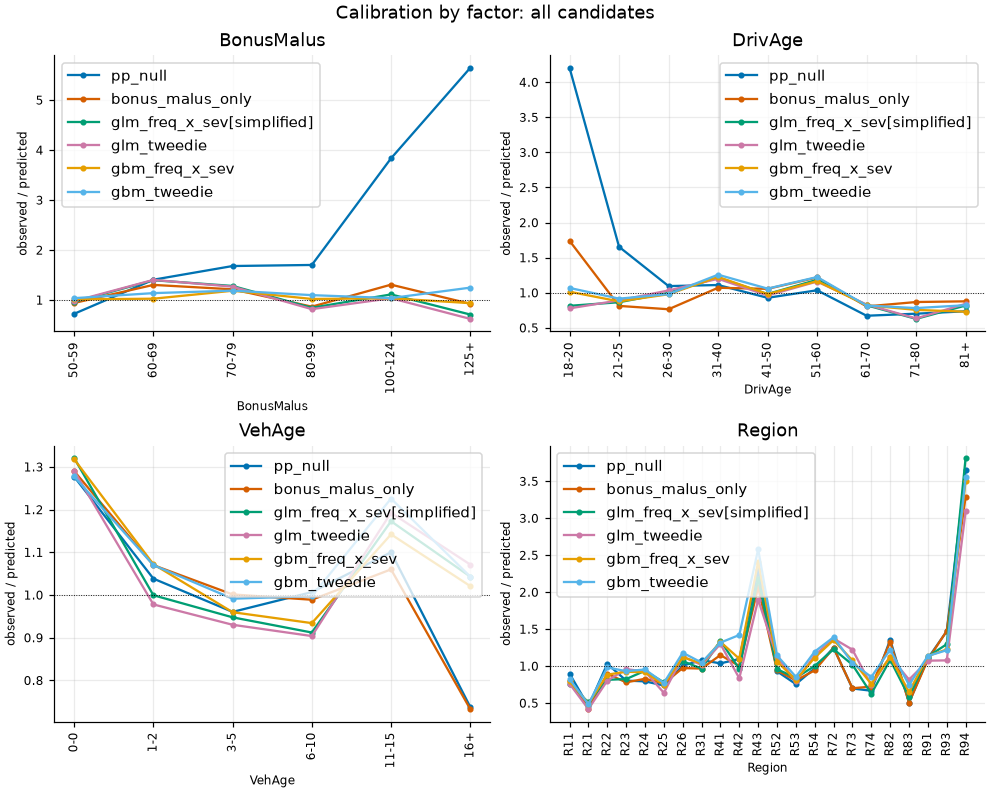
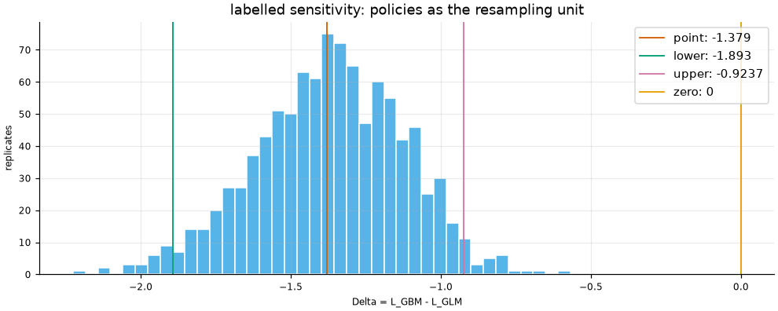

# Test evaluation report

Generated by `fremtpl2 report` from `results/metrics.json` and the completed attempt it points to (`results/test/attempt-1`, attempt 1, id `881b07e171f54df79ad7d64781fa8290`). The attempt files were checked against the sha256 values of the journal COMPLETE event (`7eb661ee684cb0e8...`); the pointer file has sha256 `5ea1387da39e052b...`; journal checked against its mirror. No number in this report is typed by hand.

Population: the primary grouped test fold (135602 policies, 71737.2 exposure-years, 5321 claims on 4978 policies; 105759 rating-profile groups). Frozen manifest `d4359feab2b44c2d...`, evaluated commit `6f716c76c870`, training commit `73c74ec50666`. Models are fitted on the training set only and are frozen; this report conditions on them.

## 1. Primary contrast and decision (protocol section 6)

Single primary contrast: Delta = L_GBM - L_GLM, the selected GBM and GLM pure-premium candidates (chosen in CV by section 4) on the primary loss. The Gini difference is secondary; all other pairs are descriptive.

Selected GBM: `gbm_freq_x_sev`. Selected GLM: `glm_freq_x_sev[simplified]`. Primary loss L: exposure-weighted Tweedie deviance of S_cap / Exposure at power 1.5 (`models.tweedie.reference_power`), per exposure-year.

Decision: improvement is claimed iff the upper interval endpoint of Delta < 0; deterioration iff the lower endpoint > 0; otherwise no demonstrated difference.

| quantity | point | lower | upper | level | replicates | units |
| --- | --- | --- | --- | --- | --- | --- |
| Delta = L_GBM - L_GLM | -1.37922 | -2.12406 | -0.77571 | 0.95 | 1000 | 105759 group_id |

**Result: improvement.** The upper endpoint of the Delta interval is -0.77571 and the lower endpoint is -2.12406.

The interval is a percentile interval of a paired bootstrap that resamples whole rating-profile groups (linear quantiles, seed 20260102); it is conditional on the frozen fitted models. Retraining, tuning and selection variability are not included, and treating profiles as independent units is an assumption. The inference concerns held-out rating profiles of this dataset only.

Secondary: normalised Gini difference (`normalised Gini(gbm_freq_x_sev) - normalised Gini(glm_freq_x_sev[simplified])`): point 0.05891, interval [0.02616, 0.10615]. It is secondary and carries no decision rule.

## 2. All prespecified candidates (descriptive)

Every prespecified candidate is reported regardless of outcome. Pairs other than the primary contrast are descriptive only: no interval or test is attached to them.

| candidate | primary loss L | Tweedie deviance / exposure (own power) | power | Poisson deviance / exposure | normalised Gini | observed / predicted total |
| --- | --- | --- | --- | --- | --- | --- |
| pp_null | 78.1971 | 78.1971 | 1.50 | 1192.7645 | 0.0000 | 1.0130 |
| bonus_malus_only | 75.5099 | 75.5099 | 1.50 | 1157.6116 | 0.2653 | 1.0129 |
| glm_freq_x_sev[simplified] (selected GLM) | 74.5675 | 74.5675 | 1.50 | 1147.0913 | 0.3136 | 1.0148 |
| glm_tweedie | 74.4148 | 74.4148 | 1.50 | 1146.6197 | 0.3192 | 1.0081 |
| gbm_freq_x_sev (selected GBM) | 73.1882 | 73.1882 | 1.50 | 1129.8577 | 0.3725 | 1.0303 |
| gbm_tweedie | 73.5038 | 73.5038 | 1.50 | 1134.2211 | 0.3572 | 1.0731 |

Components of the frequency x severity candidates (descriptive):

| candidate | frequency Poisson deviance / exposure | frequency normalised Gini | frequency observed / predicted | severity Gamma deviance / claim | severity observed / predicted |
| --- | --- | --- | --- | --- | --- |
| pp_null | 0.4835 | 0.0000 | 1.0065 | 1.3232 | 1.0065 |
| bonus_malus_only | 0.4695 | 0.2242 | 1.0064 | 1.3232 | 1.0065 |
| glm_freq_x_sev[simplified] | 0.4637 | 0.2887 | 1.0072 | 1.3330 | 1.0094 |
| gbm_freq_x_sev | 0.4564 | 0.3306 | 1.0075 | 1.3230 | 1.0231 |

## 3. Double lift: selected GBM against selected GLM

| decile | exposure | observed | predicted gbm_freq_x_sev | predicted glm_freq_x_sev[simplified] | observed / GBM | observed / GLM |
| --- | --- | --- | --- | --- | --- | --- |
| 1 | 7174.1 | 698745 | 865626 | 1419551 | 0.8072 | 0.4922 |
| 2 | 7173.8 | 824122 | 737721 | 975253 | 1.1171 | 0.8450 |
| 3 | 7173.2 | 775998 | 745995 | 915938 | 1.0402 | 0.8472 |
| 4 | 7174.1 | 671850 | 783642 | 907609 | 0.8573 | 0.7402 |
| 5 | 7173.3 | 836611 | 812391 | 891038 | 1.0298 | 0.9389 |
| 6 | 7173.9 | 915077 | 854051 | 884517 | 1.0715 | 1.0345 |
| 7 | 7173.6 | 973910 | 934697 | 907099 | 1.0420 | 1.0737 |
| 8 | 7174.1 | 1030391 | 996749 | 897932 | 1.0338 | 1.1475 |
| 9 | 7173.2 | 1266662 | 1148200 | 934879 | 1.1032 | 1.3549 |
| 10 | 7173.9 | 1978167 | 1798855 | 1092439 | 1.0997 | 1.8108 |

## 4. Calibration

By predicted-rate decile (equal exposure) and by factor; values are observed capped cost divided by predicted capped cost.

## 5. Loaded premium (reported separately)

loaded premium = capped prediction + training-only flat excess loading per exposure-year; reported separately, never compared with capped targets, no claim of predictive adequacy.

Loading per exposure-year (training only): 35.5054; observed uncapped total: 10401895.

| candidate | predicted loaded total | observed uncapped / loaded |
| --- | --- | --- |
| pp_null | 12390905 | 0.8395 |
| bonus_malus_only | 12391744 | 0.8394 |
| glm_freq_x_sev[simplified] | 12373314 | 0.8407 |
| glm_tweedie | 12438299 | 0.8363 |
| gbm_freq_x_sev | 12224985 | 0.8509 |
| gbm_tweedie | 11839480 | 0.8786 |

## 6. Bootstrap intervals

Primary (primary: rating-profile groups); conditional on the frozen models; 1000 replicates, level 0.95:

| quantity | point | lower | upper |
| --- | --- | --- | --- |
| loss:pp_null | 78.19709 | 74.50047 | 81.95832 |
| loss:bonus_malus_only | 75.50991 | 71.95524 | 79.22995 |
| loss:glm_freq_x_sev[simplified] | 74.56746 | 70.84867 | 78.50365 |
| loss:glm_tweedie | 74.41483 | 70.73897 | 78.29817 |
| loss:gbm_freq_x_sev | 73.18825 | 69.63109 | 76.97152 |
| loss:gbm_tweedie | 73.50381 | 69.81175 | 77.36036 |
| delta | -1.37922 | -2.12406 | -0.77571 |
| gini_normalized:gbm | 0.37253 | 0.32707 | 0.41615 |
| gini_normalized:glm | 0.31361 | 0.25771 | 0.36465 |
| gini_difference | 0.05891 | 0.02616 | 0.10615 |

Sensitivity (labelled sensitivity: policies as the resampling unit): this is a labelled sensitivity and never a confirmatory claim. Delta point -1.37922, interval [-1.89286, -0.92372] (rule applied to this interval: improvement); 135602 units, 1000 replicates, seed 20260102.

## 7. Rating-profile groups (the bootstrap unit)

| quantity | value |
| --- | --- |
| groups | 105759 |
| policies | 135602 |
| exposure-years | 71737.2 |
| group size quantiles | q0.5: 1.0, q0.9: 2.0, q0.99: 4.0 |
| largest group (policies) | 22 |
| top 1058 groups (0.01 of the groups) | 5.0% of the policies, 1.4% of the exposure |

## 8. Attempts in the journal

Every attempt recorded in `results/test_access.json` is listed, failed or interrupted ones included (error type only, no metric).

| attempt | id | opened (UTC) | technical rerun | status | error type |
| --- | --- | --- | --- | --- | --- |
| 1 | 881b07e171f54df79ad7d64781fa8290 | 2026-11-08T14:59:18.661442+00:00 | False | COMPLETE | - |

Self-check before test access: 547 stored train predictions reproduced, max relative difference 0.00e+00 (tolerance 1e-10).

Conditional on: frozen fitted models; retraining, tuning and selection variability are not included.
